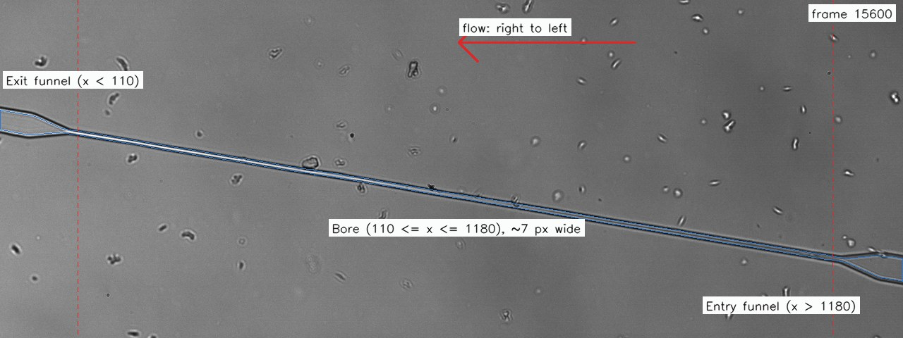
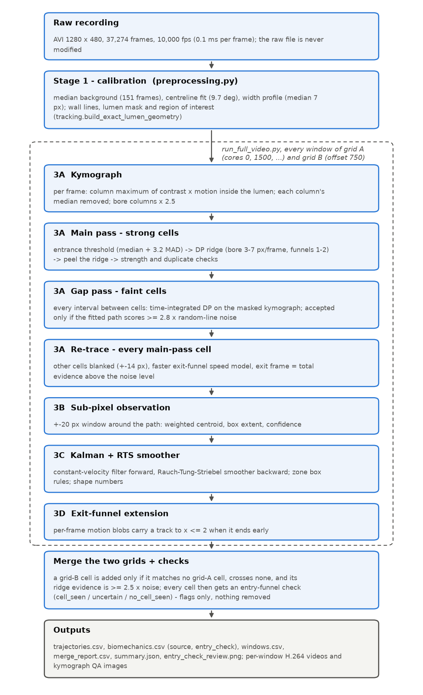
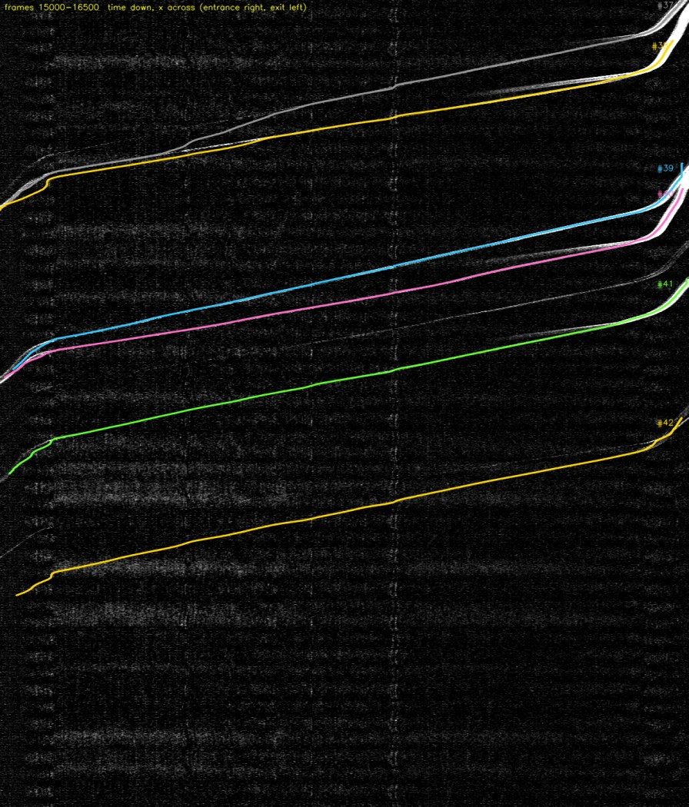
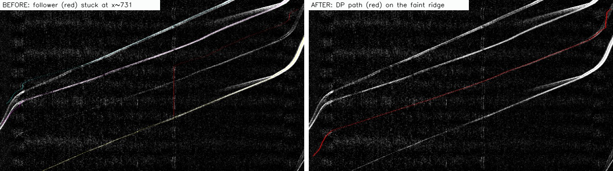
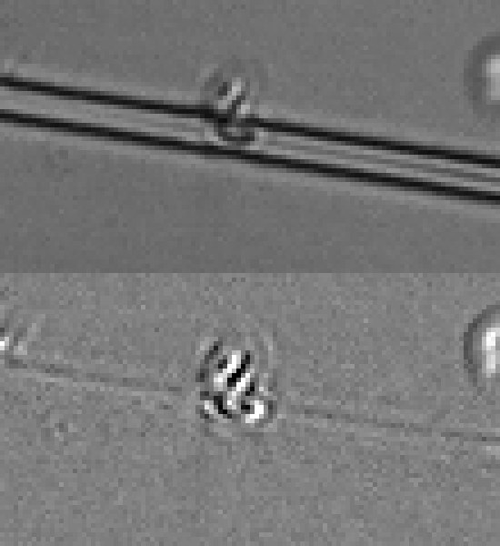
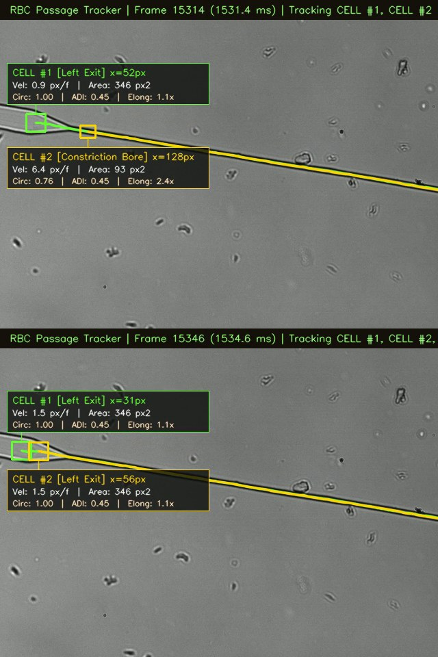
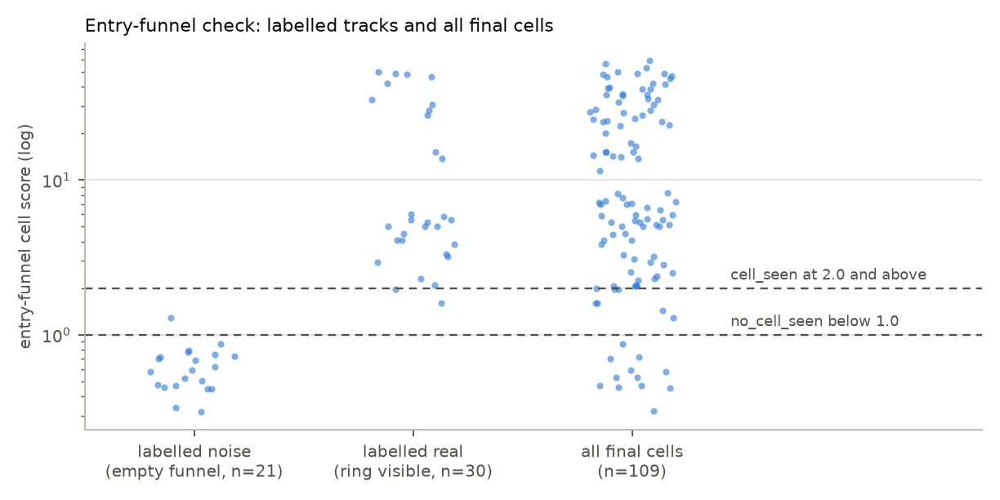
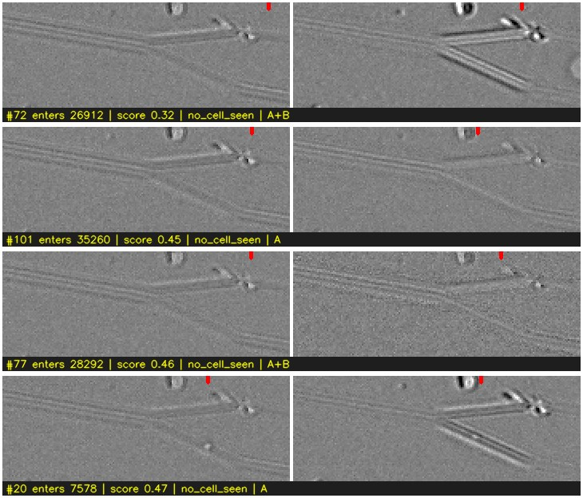
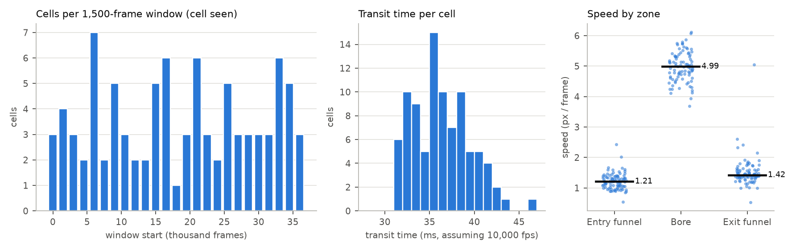
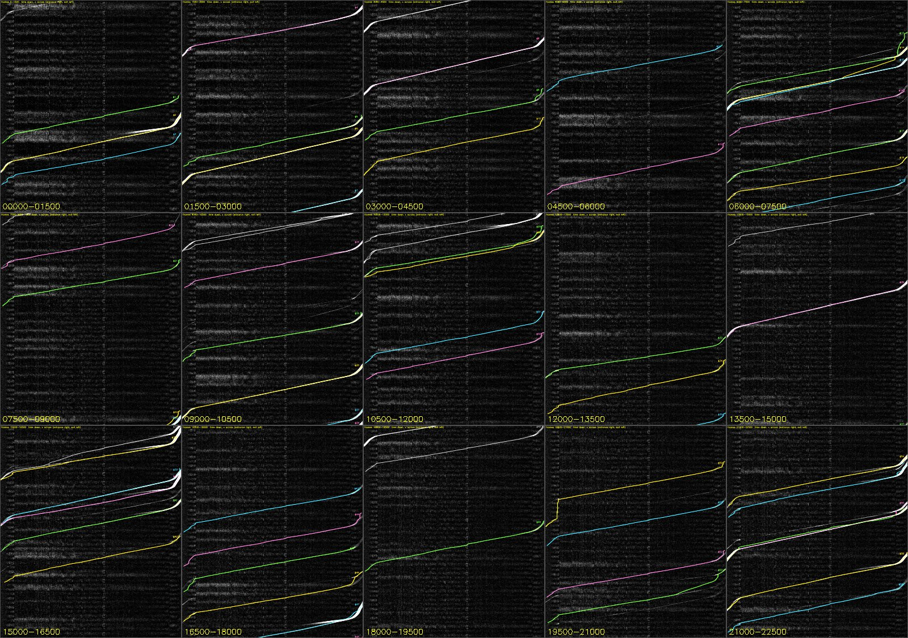

# RBC Passage Tracking Through a Glass Micro-Constriction — Pipeline Description

*Project: iisc-rbc-tracking · Compiled 2026-11-18 from the lab notebook (`lab/`), the code (`preprocessing.py`, `tracking.py`, `run_full_video.py`) and the whole-video results. Work in progress: all lengths are in pixels and all speeds in pixels per frame, because no µm/pixel calibration exists.*

<<<TOC>>>

<<<PAGEBREAK>>>

## 1. Summary

The goal is to follow every red blood cell (RBC) as it passes through a narrow glass capillary in one high-speed brightfield recording. For each cell we want its path, timing, speed and shape. Cells arrive from a bath on the right, enter a wide **entry funnel**, squeeze through a long narrow **bore** (about 7 px wide, while a resting RBC is about 18 px across), and leave through a wide **exit funnel** on the left.

The working pipeline is purely algorithmic (classical computer vision, no machine learning and no language model looking at the video):

- **Stage 1 — calibration.** A median background image, the channel centreline and the wall positions are computed once for the video.
- **Stage 3 — tracking.** Along the channel, each frame is reduced to one row of a **kymograph** (position along the channel × time). Each cell becomes a diagonal ridge in it. Ridges are found with a dynamic-programming (DP) path search. Faint cells are recovered by a second, time-integrated search. Paths are refined so that no cell can borrow a neighbour's ridge. A per-frame measurement and a Kalman filter with a backward (RTS) smoother then give sub-pixel positions, boxes and shape numbers.
- **Whole video.** `run_full_video.py` runs Stage 3 in overlapping 1,500-frame windows, twice with the windows shifted by 750 frames, and merges the two runs. Every final cell then gets an **entry-funnel check**: is a real cell visible where the track enters?

**Current result:** 109 cell passages tracked over all 37,274 frames (about two hours of laptop compute in total). The entry-funnel check sees a real cell for **90**, flags **12** as likely noise and **7** as uncertain; by eye the best estimate is **about 93–94 real passages**. Flagged tracks are kept, not deleted. Three windows were also checked by hand against the raw frames.

**Main known limits:**

- Some faint cells are still missed (for example the cell entering at frame 15459 when the window starts elsewhere than 15000).
- About 12 tracks are likely noise. They are flagged in the results so analyses can exclude them.
- Boxes trail the cell centre by about 5–19 px in the exit funnel.
- The shape numbers (area, circularity, ADI) come from a box model and are not yet real deformation measurements.
- There is no physical calibration.

## 2. Data and geometry

| Item | Value | Source / note |
|---|---|---|
| Recording | `2A002 2_C001H001S0001-001.avi`, 22.9 GB, 8-bit greyscale | Raw file never modified, never committed to git |
| Frame size | 1280 × 480 px | AVI header |
| Frames | 37,274 | AVI header. **Open issue:** the camera's CIHX file lists a saved range of 0–17,471; not yet reconciled |
| Frame rate | 10,000 frames/s (0.1 ms per frame) | CIHX `recordInfo/recordRate` and MII film speed. The AVI's own 30 fps is playback only |
| Spatial scale | none | No µm/pixel calibration in the metadata. All results in px and px/frame |
| Channel angle | 9.7° (slope 0.171) | Stage 1 centreline fit |
| Bore width | median 7 px (range 4–26 px including funnel ends) | Stage 1 width profile |
| Resting RBC diameter | about 18 px | Measured on free-floating cells in the bath |
| Flow direction | right → left | Cells enter at x ≈ 1279 and leave at x ≈ 0 |

The channel is divided into three zones by x position. These boundaries are used throughout the code:

| Zone | x range (px) | What cells look like |
|---|---|---|
| Entry funnel | x > 1180 | Round, slow (median 1.2 px/frame), clearly visible |
| Bore | 110 ≤ x ≤ 1180 | Squeezed to 4–9 px height, fast (median 5.0 px/frame), faint |
| Exit funnel | x < 110 | Rings ("C" or "9" shapes), slowing from about 4 to about 1.2 px/frame; the funnel walls flicker in background-subtracted images because the tube jitters slightly |

{width=1.0}

## 3. Pipeline overview

Figure 2 shows the flow; the table lists where each step lives in the code.

| Step | Code | Output |
|---|---|---|
| Stage 1 calibration | `preprocessing.py` | `calibration.json`, `median_bg.npy` |
| Lumen geometry | `tracking.build_exact_lumen_geometry` | wall lines, lumen mask, region of interest (ROI) rows |
| 3A kymograph | `tracking.detect_and_track_passages` | one energy row per frame |
| 3A main pass | `extract_next_passage_from_kymograph`, `trace_single_cell_dp_ridge`, `peel_ridge_from_kymograph`, `is_duplicate_trajectory` | strong passages |
| 3A gap pass | `find_entrance_via_components` (kymograph DP) | faint passages |
| 3A re-trace | block in `detect_and_track_passages` | corrected paths for all main-pass cells |
| 3B observation | `extract_subpixel_observation` | per-frame x, y, box, confidence |
| 3C smoothing | `kalman_rts_smooth_passage` | smoothed path, box, shape numbers |
| 3D exit extension | `extend_exit_flare` | extra frames at the exit |
| Biomarkers | `compute_biomarker` | one row per cell |
| Video | `render_tracked_video` + `_H264Writer` | H.264 MP4 |
| Whole video | `run_full_video.py` (`run_grid`) | grid A and grid B tracks per window |
| Grid merge | `merge_grids` + `ridge_evidence` | merged cells, `merge_report.csv` |
| Noise flag | `EntryChecker` | `entry_check` per cell, `entry_check_review.png` |

{width=0.92}

## 4. Stage 1 — calibration (`preprocessing.py`)

1. **Median background.** 151 frames are sampled evenly across the whole AVI. The per-pixel temporal median is saved as `median_bg.npy`. Moving cells vanish from a median, while the glass, walls and stuck debris remain. *Caveat found later:* debris that sticks to the channel after the sampling period, such as a particle at x ≈ 731, is not in this background (see §10, Figures 4–5, and §12).
2. **Centreline.** In each column from x = 90 to W − 90, the darkest pixel of the background marks the dark channel line. A straight line is fitted with four rounds of 2σ outlier rejection. Result: slope 0.1709, intercept 167.26, residual 3.2 px.
3. **Width profile.** The background is sampled perpendicular to the centreline every 15 px, and the two dark wall minima give the width. The median is 7 px.
4. **Lumen mask** (in `tracking.py`). For each column the wall search reaches ±28 px from the centreline in the funnels (x < 115 or x > 1165) and ±9 px in the bore. The top and bottom walls are the darkest pixels above and below the centre, smoothed with a 15-column median. The lumen is the band between them, peeled by 4.5 px in the funnels and 1.2 px in the bore (minimum half-width 2.2 px). The region of interest is the lumen's row span ± 6 px; only that strip is decoded and kept in memory (about 326 KB per frame).

## 5. Stage 3A — the kymograph

For every frame, inside the lumen mask:

- **Contrast:** `abs_diff = |frame − background|` and `pos_diff = max(0, frame − background)` (brightening only).
- **Motion:** `|frame − frame three frames earlier|`.
- **Column score:** in the bore, `sqrt(max_col(abs_diff) × max(0, max_col(motion) − 4))`. In the funnels, `pos_diff` is used instead, ×1.4.

Each column then has its temporal median subtracted, and the bore columns are multiplied by 2.5 so the squeezed cell gives a ridge as strong as in the wide funnels. The result is an image with time going down and x across, where every passage is a diagonal ridge from the top right (entry) to the bottom left (exit).

{width=0.62}

## 6. Stage 3A — finding passages

### 6.1 Main pass (strong cells)

1. **Entrance signal.** `r(t)` = the kymograph maximum over x = 1215–1278, smoothed over 7 frames. Threshold `r_thresh = max(8, median + 3.2 × MAD)`, computed over the window (MAD = median absolute deviation).
2. **Next entrance.** The first frame where `r(t)` exceeds the threshold (ignoring the last 150 frames). The peak within the next 20 frames is taken, then the start is walked back up to 14 frames while the edge signal (x 1245–1278) stays above 0.45 × `r_thresh`.
3. **DP ridge trace.** On the kymograph blurred with an (11 × 3) Gaussian, the path starts at x ≥ 1225 and must move left every frame:
   - bore steps of 3–7 px/frame (preferred speed 5.1);
   - funnel steps of 1–2 px/frame (preferred speed 1.2);
   - a cost of 0.55 × (step − preferred speed)²;
   - standing still is not allowed.

   The passage must last 330–435 frames. Its exit frame is chosen by average score plus 1.5 × the exit-funnel signal, and the path is trimmed where it first reaches x ≤ 14. Paths shorter than 180 frames are discarded.
4. **Peel.** The accepted ridge is erased from a working copy of the kymograph (±34 px, ±4 frames, plus the entrance region) so the next search finds the next cell.
5. **Checks.** A candidate is rejected if any of these hold:
   - the median ridge strength along its path is below 0.55 × `r_thresh`;
   - it is a duplicate of an accepted track: entrance within 22 frames, 25th-percentile separation in the bore under 45 px, or the two paths cross.

   At most 40 cells per window.

### 6.2 Gap pass (faint cells)

Some cells are too faint to pass the entrance threshold. Their signal in any single frame is at noise level (about 3–6 against a noise 90th percentile of 3.7), so they can only be found by adding up evidence over time.

- **Where it searches.** Every interval between accepted entrances, plus before the first and after the last. A path may start no earlier than 90 frames after the previous cell. When a cell is recovered, its interval is split and both halves are searched again (at most 60 searches per window).
- **Signal.** The column-maximum of motion × contrast energy, minus each column's temporal median computed over **every** frame. Sampling every 2nd frame was a bug: this footage flickers between alternate frames, so the noise level depended on whether the interval started on an odd or even frame.
- **Masks.** Every accepted track is blanked ±20 px, so a recovered path can neither ride nor cross another cell.
- **DP.** Bore steps of 0–9 px/frame (preferred speed 5), funnel steps of 0–4 (preferred 1.5), cost 0.35 × (step − preferred)², stall penalty 1.5. The path may start anywhere at x ≥ 1150 within the interval and must end at x ≤ 14. The signal has its 75th percentile subtracted, so noise counts against a path and the path begins where the ridge begins.
- **Validation without selection bias.** A quadratic x(t) is fitted to the bore part of the path, and the median energy (9-column maximum) along that curve is computed. It must be at least **2.8 ×** the same statistic on 300 random straight lines moving at bore speeds (3.5–6.5 px/frame).
  - Calibration: paths through pure noise score 1.1–1.9×; recovered real cells score 3.2–3.5×.
- **Then:** a strength floor, truncation where the path comes within 20 px of an existing track, a "ghost" check (median separation under 35 px over the first 20 shared frames), and a minimum of 22 frames between entrances.

### 6.3 Re-trace (neighbour-masked)

Each main-pass passage was traced on its own, so its path could be pulled onto a brighter neighbour's ridge or end at the wrong frame. Every main-pass track is therefore traced again with these settings, for two rounds:

- the other tracks are blanked (±14 px, ±4 frames);
- the exit funnel uses a faster speed model: steps 1–5 px/frame, preferred speed easing 4.0 → 1.5 → 1.2 over x = 110 → 70 → 0;
- the exit frame is chosen by **total evidence above the noise level**: total DP score − (75th-percentile noise × duration), with no averaging and no exit-funnel bonus.

The main pass keeps the original rules, so which cells are accepted does not change. Gap-recovered tracks are not re-traced (they come from a different model), but they still blank their band for the others.

## 7. Stages 3B–3D — measurement and smoothing

### 7.1 Sub-pixel observation (3B)

For each frame of a path, a window ±20 px around the path's x position is examined:

- **Energy:** contrast × sqrt(motion). Brightening-only contrast is used in the funnels, absolute contrast in the bore. The energy is blurred with a (5 × 3) Gaussian.
- **Measurement:** if the peak energy is at least 12, the pixels above 0.48 × peak give an energy^1.5-weighted centroid. The measured y is blended 45 % with 55 % of the wall centre.
- **Confidence:** peak / 80, clipped to 0.15–1. If no measurement is found, the path's own position is used with confidence 0.05.

### 7.2 Kalman filter + RTS smoother (3C)

- **Model:** a constant-velocity Kalman filter with state (x, y, vx, vy) and process noise diag(0.35, 0.08, 0.25, 0.02). The measurement noise comes from confidence (σ = 2.2 / confidence), so weak frames count less.
- **Smoothing:** a forward pass, then a Rauch–Tung–Striebel backward pass, which gives zero-lag smoothed positions.
- **Afterwards:** x is not allowed to move backwards (right). y is kept within the lumen with a smooth ramp. Box sizes are clipped per zone: funnels 13–22 × 12–20 px; bore 15–26 px wide and 5–9 px high (at most lumen height + 2).
- **Derived numbers:** area, circularity and elongation are computed from the ellipse that fits the box. Speed is the frame-to-frame displacement.

### 7.3 Exit-funnel extension (3D)

If a track ends at x ≤ 260, it is extended frame by frame in the exit funnel. The method:

- per-frame motion-gated blobs (threshold: the 99th percentile inside the lumen; area ≥ 20 px);
- each step must move left by at most 6 px;
- up to 200 frames, stopping at x ≤ 2.

## 8. Outputs per cell

`compute_biomarker` gives, per cell:

- entrance and exit frame, length, duration in ms (frames ÷ 10);
- start and end x, net travel;
- mean and maximum speed (px/frame);
- mean and minimum area;
- mean and minimum circularity, maximum elongation;
- ADI = minimum area ÷ mean area;
- a shape-recovery ratio.

> **Important caveat.** Area, circularity, elongation and ADI are computed from the zone-clipped box model of §7.2, not from segmented cell outlines. They mostly reflect the zone rules and must not be reported as deformation measurements until a real segmentation is validated.

The tracked video (`render_tracked_video`) draws boxes, trails and an information card per cell on every frame that has a cell (± 20 frames). Since 2026-11-16 it writes H.264: frames are piped to ffmpeg (libx264, quality setting CRF 18), with OpenCV `avc1`, then `mp4v`, as fallbacks. The earlier `mp4v` files did not play in browsers or the editor's viewer.

## 9. Whole video — `run_full_video.py`

The tracker keeps every decoded strip in memory, so a single pass over 37,274 frames would need about 12 GB (the laptop has 15.6 GB). The video is therefore processed in windows:

- **Core:** 1,500 frames, the size validated by hand. Cores start at 0, 1500, 3000, … (25 windows).
- **Pre-roll:** 450 frames decoded before each core, so a cell entering just before the core can be masked during the re-trace.
- **Post-roll:** 450 frames after each core. That is longer than the longest passage (435 frames), so every cell entering in the core finishes inside its window.
- **Ownership:** a cell belongs to the window whose core contains its entrance frame, so nothing is counted twice.
- **Safe saving:** each window writes its own files atomically (`per_window/`), and the combined CSVs are rebuilt from them. `--resume` continues an interrupted run without duplicating rows.
- **Quality-check outputs:** one tracked video and one kymograph image (tracks drawn on the ridges) per window.

### 9.1 Two window grids

Whether a faint cell is found depends on where its window starts, because thresholds and gap intervals are computed from the frames that are loaded. So a second grid, **grid B**, is run with its windows shifted by 750 frames (cores at 750, 2250, …), saved in `per_window_b/`. **Grid A** (cores at 0, 1500, …) is the base and is never changed. Each grid-B track is classed as:

- **the same cell** as a grid-A track: median distance under 20 px over at least 20 shared frames in the bore. The cell is labelled `A+B` (found by both grids);
- **a conflict:** it shares more than 30 % of its bore frames with a kept track within 14 px, or crosses one (cells cannot overtake in the bore). Reported, not added;
- **a new cell:** added (`source = B`) only if its **ridge evidence** is at least **2.5 ×** noise. Ridge evidence is the median energy along the track compared with random straight lines at bore speeds over the same frames. Otherwise it is rejected.

The evidence check is essential. Without it, the first whole-video merge added 14 tracks, and only 3 of them showed a real cell (§10.1).

Cells are then renumbered by entrance frame. `merge_report.csv` lists every grid-B track with its verdict and score. Videos and kymographs are re-rendered only for windows whose drawn cells changed.

### 9.2 Entry-funnel cell check (noise flag)

In the entry funnel, real cells are clearly visible as round rings, while noise tracks show an empty funnel. For every final cell:

- **Background:** per grid-A window, a local background (median of every 8th frame) and each pixel's typical jitter are built on a crop of the entry funnel.
- **Score:** on up to 8 frames while the track is in the funnel, the strongest cell-sized blob within ±25 px of the track, after removing the frame's flicker offset and 1.5 × the jitter. The score is the median over those frames.
- **Flag:** `cell_seen` (score ≥ 2.0), `uncertain` (1.0–2.0) or `no_cell_seen` (< 1.0), written to `biomechanics.csv`. Every flagged track appears in `entry_check_review.png`. **Nothing is removed.**

### 9.3 Running it

To run from VS Code: open the `iisc-rbc-tracking` folder, then Run and Debug → "RBC - full video (resumes if stopped)" → Ctrl+F5. Or from a terminal: `py run_full_video.py --resume` (add `--no-offset-grid` to skip grid B). Results go to `Desktop\RBC_full_video_results\`.

Compute time on the laptop: grid A 53 min; grid B, merge and rendering 62 min; entry check 5 min. A resumed run reuses everything already done.

## 10. Validation

There is no labelled ground truth. Each fix was checked in two independent ways:

- **Kymograph overlays:** does every ridge have a track on it, and does each track stay on its ridge?
- **Background-subtracted crops of the raw frames:** in the funnels the cells are visible as rings, so box positions can be compared with the real cell position frame by frame.

Three 1,500-frame windows were checked closely:

| Window (frames) | Cells | What was checked / fixed |
|---|---|---|
| 1450–2950 | 3 (1543→1899, 2313→2672, 2396→2805) | Old code produced a ghost 4th track stuck on debris (removed). Cell 2's box trailed its cell by 40–50 px and outlived it (exit corrected 2714 → 2672) |
| 15000–16500 | 6 confirmed by eye, + a real 7th found later (entering about 15776) | Faint cell entering 15459 recovered. Cell 1 no longer stalls at the exit throat or rides cell 2. Cell 3 no longer races ahead and exits about 47 frames early |
| 18000–19500 | 2 (+1 cell already in the bore at the window start, untrackable by design) | 11 weak entrance candidates correctly rejected (no ridge behind them). Exits now follow the faint cells to the funnel end |

{width=1.0}

{width=0.34}

{width=0.42}

{width=0.62}

### 10.1 Checking the whole-video result

The whole-video result was checked in three ways:

- **Grid-B additions.** The first merge added 14 cells. Entry-funnel crops at each track's start showed a real cell for only 3 (entering 6628, 7260 and 23898). Ten showed an empty funnel, and one was the next cell arriving. Their ridge evidence separated cleanly: real 2.82–3.43, noise 1.07–1.91. That set the 2.5 cutoff in §9.1. Ten of the 14 lasted exactly 327–331 frames, the shortest passage the main-pass search allows, which is what a path through noise produces.
- **Ridge evidence on all tracks — not reliable for deleting cells.** It scored 29 of the then 120 tracks below 2.0. But crops showed some of them were clearly real, bright cells whose path leaves the ridge further down the channel. So ridge evidence is used only to gate grid-B additions.
- **Entry-funnel check (§9.2).** Calibrated on tracks labelled by eye from crops: 21 empty-funnel tracks scored 0.32–1.28 (median 0.59), and 30 real cells scored 1.61–50 (median 5.4). On the 109 final cells it gives 90 `cell_seen`, 7 `uncertain` and 12 `no_cell_seen`, with no contradiction of any eye label. All 12 `no_cell_seen` tracks show an empty funnel on the review sheet. By eye, the 7 uncertain tracks split into 3 real-looking, 3 noise-looking and 1 unclear.

{width=0.9}

{width=0.62}

## 11. Whole-video results

**109 cells** were tracked over frames 0–37,274. All tracks run the full channel (none stops mid-channel).

| Group | Cells |
|---|---|
| Found by both grids (`A+B`) | 92 |
| Grid A only | 14 |
| Added by grid B (passed the ridge-evidence check) | 3 |
| Entry check: `cell_seen` | 90 |
| Entry check: `uncertain` | 7 |
| Entry check: `no_cell_seen` (likely noise) | 12 (6 of them found by both grids) |

Being found by both grids is not proof of a real cell: 6 of the 12 likely-noise tracks were found twice. The statistics below use the **90 `cell_seen` cells**:

| Measure | Median | Interquartile range | Note |
|---|---|---|---|
| Transit time | 360 frames (36.0 ms) | 335–383 frames | The main-pass search only allows 330–435 frames, so this range is partly imposed by the model |
| Mean speed per cell | 3.55 px/frame | 3.36–3.79 | Whole passage including the funnels |
| Bore speed (x 200–1100) | 4.99 px/frame | 4.65–5.31 | Close to the search's preferred speed of 5.1, so partly a model setting |
| Entry-funnel speed | 1.21 px/frame | 1.05–1.37 | Preferred speed 1.2 |
| Exit-funnel speed | 1.42 px/frame | 1.34–1.59 | |
| Time between entrances | 285 frames | min 23, max 1,690 | |

{width=1.0}

{width=1.0}

## 12. How the pipeline got here (what failed and why)

Every miss is recorded in `lab/failures.md`. The main lessons:

| Problem | What we saw | Cause | Fix |
|---|---|---|---|
| Annotated screenshot used for detection | A red annotation circle would become a "wall" | Screenshot, not a raw frame | Use seeked raw AVI frames only |
| Lumen mask kept only the left flare | Bore erased | Morphological close fused the walls; "largest gap" rule | Fill between walls near the centreline; no 5 × 5 opening |
| Empty output CSVs | 0 tracks | New tracks had no Kalman state and were never matched | Initialise the Kalman filter at track creation |
| 5 of 6 cells in 15000–16500 | One cell's box froze mid-channel | Old gap follower drifted ~5 px/frame through noise (off-centre window) and stuck on debris at x ≈ 731 | Kymograph DP gap pass + fit-ratio validation |
| Ghost cell in 1450 window | Extra track stuck at x = 730 for 300+ frames | Same debris trap | Same fix |
| Cell 1 box stopped at the exit throat | Box 30–36 px behind, then on cell 2 | Independent DP pulled onto a brighter neighbour; funnel speed limit too low; measurement locked onto flickering walls | Neighbour-masked re-trace with a faster exit model |
| Cell 3 exited about 47 frames early | Box raced about 70 px ahead | Exit frame chosen by average score + exit-funnel bonus (rewards short paths and a neighbour's exit) | Exit chosen by total evidence above noise |
| Faster DP in the main pass | A 1450 cell lost | Changed which candidates passed the strength check | Faster model only in the re-trace |
| Re-tracing with an average-energy guard | Correct exits moved | Average favours paths that skip weak segments | Guard dropped |
| Per-frame blob detection in the funnels | Detections on the walls | Tube jitter makes the walls flicker in background-subtracted images | Not used; kymograph kept |
| Gap pass searched only long gaps | Results depended on window start | "1.25 × median spacing" rule | Search every interval |
| Noise reference jumped 1.9 ↔ 3.4 | Faint cells passed or failed at random | Alternate-frame flicker + every-2nd-frame sampling | Use every frame |
| Blanking cells only in the bore (to free the faint 15459 cell) | Two real cells lost, faint cell still missed | Without entry-funnel blanking, the gap search latches onto the next cell's bright entrance | Prototype dropped |
| First offset-grid merge | 14 cells added, 11 of them noise | Grid B's windows accept paths through noise in quiet stretches; path matching cannot reject a path that matches nothing | Grid-B additions need ridge evidence ≥ 2.5 |
| Noise tracks in the base result | About 12 tracks with an empty entry funnel, some found by both grids | Same main-pass acceptance in quiet stretches | Entry-funnel check flags them (not removed) |
| Ridge evidence as a general filter | Bright real cells scored as low as noise | Their paths leave the ridge further down the channel | Used only to gate grid-B additions |

## 13. The proposed sketch: nearest-neighbour in the funnels, kymograph + RTS in the bore

- **Zoning — confirmed useful.** Funnels and bore behave differently, and two fixes are zone rules (the exit-funnel speed model and the exit-frame rule).
- **Kymograph + RTS in the bore — already the core of `tracking.py`.** The RTS smoother only smooths a path that has already been found; it cannot recover a missed cell. The misses were fixed in how paths are found in the kymograph.
- **K-nearest-neighbour in the funnels — not usable on this footage yet.** Exit-funnel cells are faint, slow rings, and the funnel walls flicker. A per-frame nearest-neighbour match locks onto walls, the same failure as the debris trap. Visible funnel cells were, however, the main way every fix was checked. If used later, Kalman + Hungarian (one-to-one) matching, as in the `zone13_tracking.py` prototype, would be the safer form, ideally as an independent count of cells entering and leaving.

## 14. Limitations and next steps

- **Missed faint cells:** the two offset grids catch some placement-dependent misses (3 cells added), but the faint 15459 cell is still missed whenever the cell ahead of it is placed at entrance 15350. Its blanked band hides the faint cell's start, and blanking only in the bore made things worse.
- **Flagged noise tracks:** 12 tracks are flagged `no_cell_seen` and 7 `uncertain`. They are kept in all outputs and videos. Next: decide whether analyses use only `cell_seen`, and confirm the uncertain ones on `entry_check_review.png`. Longer term, stop such tracks being accepted in the first place.
- **Exit-funnel lag:** boxes trail the cell centre by 5–19 px; one box (15000 window, cell 4) runs slightly ahead in its last frames.
- **Shape numbers:** the box model is not a deformation measurement. A validated segmentation in the funnels is needed before reporting ADI.
- **Model-shaped statistics:** transit-time limits and preferred speeds influence the reported speeds and durations; they should be loosened or estimated from the data.
- **Calibration and timing:** no µm/pixel scale. The AVI frame count (37,274) disagrees with the CIHX saved range (0–17,471), so the 0.1 ms per frame assumption needs checking before any physical speed is reported.
- **Untrackable by design:** cells already inside the channel at frame 0, and cells entering in the last ~260 frames.
- **Version control:** today's code is not yet committed. The git sync is blocked because local `master` has diverged from `origin`.

## Appendix A — Files

| Path | Purpose |
|---|---|
| `preprocessing.py` | Stage 1 calibration |
| `tracking.py` | Stage 3 tracker (single window); `--start-frame`, `--max-frames`; `RBC_DEBUG_ENTRANCES=1` prints every decision |
| `run_full_video.py` | Whole-video runner: two window grids, merge with ridge-evidence check, entry-funnel noise flag, resume, per-window videos/kymographs |
| `zone13_tracking.py` | Prototype: funnel detection + Kalman + Hungarian (not in the main pipeline) |
| `.vscode/launch.json`, `.vscode/settings.json` | VS Code run configurations and interpreter (machine-specific, not committed) |
| `lab/` | Lab notebook: `CURRENT.md`, `log.md`, `decisions.md`, `failures.md`, `evidence/` |
| `C:\Users\amara\rbc_tracking\output\` | Stage 1 outputs and saved single-window runs |
| `Desktop\RBC_full_video_results\` | Whole-video results |

## Appendix B — Output columns

**trajectories.csv** (one row per cell per frame): frame, track_id, cx, cy, bbox_x, bbox_y, bbox_w, bbox_h, velocity_px_per_frame, area, circularity, elongation, ADI_running.

**biomechanics.csv** (one row per cell): track_id, entrance_frame, exit_frame, track_length_frames, duration_ms, x_start_px, x_end_px, net_travel_px, velocity_mean, velocity_max, area_mean, area_min, circularity_mean, circularity_min, elongation_max, ADI, shape_recovery, window_core_start, source (A / A+B / B), entry_cell_score, entry_check (cell_seen / uncertain / no_cell_seen).

**windows.csv:** grid, core_start, core_end, decode_start, decode_end, cells_detected_in_window, cells_kept, kept_track_ids, seconds.

**merge_report.csv** (one row per grid-B track): grid_b_track, entrance_frame, exit_frame, verdict (duplicate / added / conflict / rejected), final_track_id, matched_grid_a_track, shared_bore_frames, median_distance_px, ridge_ratio, note.

**Other files:** `summary.json` (totals by source and by entry check, settings), `entry_check_review.png` (crops of every flagged track), `ridge_scores.json` and `entry_scores.json` (cached scores), `per_window/` and `per_window_b/` (raw results per window and grid).
